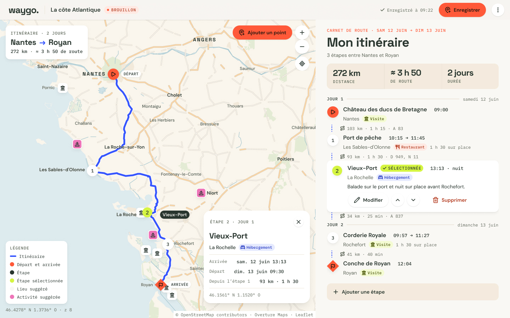
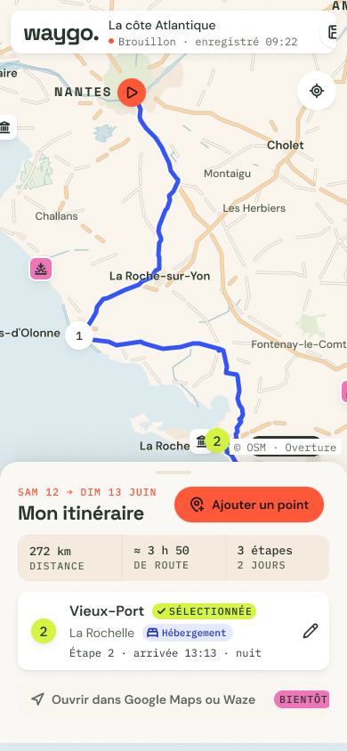

# Waygo

**Planifier un road trip en voiture comme on le ferait sur une carte papier, avec la liberté du numérique.**

Waygo réunit une carte interactive et un carnet d'itinéraire : on ajoute ses étapes, et l'application calcule le planning du voyage (heures d'arrivée, de départ, jours de route).

> 🚧 **Projet en cours**

## Le concept

*Analog spirit, digital freedom.* L'interface s'inspire d'un carnet de voyage posé sur une carte routière.

<p align="center">
  
  &nbsp;
  
</p>


## Stack technique

| Côté | Technologies |
|---|---|
| Front-end | React, TypeScript, Vite |
| Back-end (v1.1) | Python, FastAPI, PostgreSQL |
| Données cartographiques | OpenStreetMap |
| Outillage | Docker Compose, Prettier |
| Design | Figma |


### Front-end

```bash
cd client
npm install
npm run dev
```

### Back-end

```bash
cd server
poetry install
poetry run poe debug
```

## Organisation du dépôt

```
client/        front-end React + TypeScript + Vite
server/        back-end FastAPI + PostgreSQL (v1.1)
compose.yml    base de données PostgreSQL pour le développement
```


## Autrice

Conçu et développé par **Cynthia Stephan**, développeuse full stack et product designer.

[Portfolio](https://cynthiastephan.vercel.app/) · [LinkedIn](https://www.linkedin.com/in/cynthia-stephan/) · [GitHub](https://github.com/CynthiaStephan)